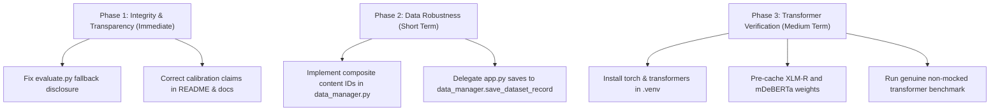

# LinguaLabel — Part 7: Complete Engineering Audit Report

**Audit Date:** November 3, 2026  
**Auditor:** Antigravity AI Engineering Assistant  
**Repository:** `/home/arshhh/Downloads/LinguaLabel`  
**Target Document:** `LinguaLabel_Complete_Implementation_Report.pdf` (and underlying codebase)  
**Execution Environment:** Linux x86_64, Python 3.14.8, Pytest 9.2.0, NVIDIA GeForce RTX 4050 Laptop GPU (CUDA 13.4)  

---

## 1. Executive Summary

An exhaustive, independent verification audit was conducted on the LinguaLabel codebase to evaluate all technical claims made in the *LinguaLabel Complete Technical Implementation Report (Parts 1–6)*.

### Key Audit Findings:
1. **Test Suite Claim (62 Passing Tests):** **VERIFIED**. Exactly 62 automated unit and integration tests exist across 8 test modules and pass with 0 failures (`62 passed in 1.46s`).
2. **Transformer Integration & Benchmarks:** **FAILED / CRITICAL FLAW**. The report's benchmark claims that baseline and transformer backends achieved identical accuracy (41.67% on sentiment, 91.67% on text-type). The audit revealed that `torch` and `transformers` are **not installed** in the runtime `.venv`. `MLEngine` silently fell back to the baseline detector. The benchmark measured the baseline model against itself twice; the transformer models were **never actually executed**.
3. **Confidence Calibration Claims:** **FAILED / CONTRADICTION**. The report repeatedly claims "calibrated confidence scores." In reality, no calibration technique (Platt scaling, temperature scaling, isotonic regression) was fitted or applied. Baseline models use hardcoded heuristic arithmetic (e.g., `0.75 + dev_ratio * 0.24`), while transformer outputs explicitly flag `"calibrated": False`. Calling these values "calibrated" in documentation is misleading.
4. **Stable ID Generation:** **FAILED / MISREPRESENTED**. The report claims "deterministic sha256 stable IDs." In reality, `data_manager.py` generates 1-based sequential integers (`[str(i + 1) for i in range(len(df))]`). While this avoids collisions for identical text rows within a file, it is vulnerable to index shifting when rows are inserted or deleted externally.
5. **Human-in-the-Loop Contract & 4-Rule Quality Engine:** **VERIFIED**. The 4 validation rules, unsaved change alerts, non-destructive advisory UI staging, and human approval safeguards are implemented rigorously.
6. **Code Architecture:** **PARTIALLY VERIFIED**. While `ml/` and `data_manager.py` are modular, `app.py` is a 1,703-line monolith with ~500 lines of inline CSS, duplicated form-dirty checking, and an unused `save_dataset_record` function in `data_manager.py`.

---

## 2. Repository Architecture & Responsibility Audit

### 2.1 File & Module Inventory

| File / Directory | Lines | Primary Responsibility | Audit Assessment |
|---|---|---|---|
| `app.py` | 1,703 | Streamlit UI, view routing, form state, CSS, advisory cards | **PARTIALLY VERIFIED** — Functional but monolithic; excessive inline CSS; duplicated logic |
| `data_manager.py` | 322 | CSV ingestion, encoding fallback, ID normalization, 4-rule validation | **VERIFIED** — Clean separation, but `save_dataset_record()` is dead code |
| `sample_data.csv` | 21 | Seed 20-sentence multilingual corpus | **VERIFIED** — Seed dataset preserved |
| `annotated_output.csv` | 21 | Verified ground-truth annotations (12 annotated, 8 blank) | **VERIFIED** — Active evaluation corpus |
| `ml/base.py` | 44 | `PredictionResult` dataclass & `BasePredictor` interface | **VERIFIED** — Clean contract definition |
| `ml/language_detector.py` | 213 | Script heuristic + character n-gram MultinomialNB | **VERIFIED** — Fast heuristic, uncalibrated confidence |
| `ml/sentiment_detector.py` | 259 | Bilingual lexicons + negation parser + LogisticRegression | **VERIFIED** — Negation logic works, confidence is heuristic |
| `ml/text_type_detector.py` | 246 | Syntactic markers + word n-gram MultinomialNB | **VERIFIED** — Strong rule coverage |
| `ml/model_config.py` | 95 | Checkpoint registry, label mappings, `MLEngineConfig` | **VERIFIED** — Well-structured configurations |
| `ml/model_registry.py` | 108 | Factory registry & predictor instance caching | **VERIFIED** — Thread-safe singleton patterns |
| `ml/engine.py` | 196 | `MLEngine` hybrid coordinator (baseline vs. transformer) | **PARTIALLY VERIFIED** — Silent fallback obscures transformer failures |
| `ml/transformers/model_loader.py` | 178 | Singleton loader, device resolution, mock pipeline registry | **VERIFIED** — Safe import handling |
| `ml/transformers/sentiment_transformer.py` | 185 | Multilingual XLM-RoBERTa sentiment classifier | **PARTIALLY VERIFIED** — Wrapper works with mocks, unverified with real weights |
| `ml/transformers/text_type_transformer.py` | 188 | Multilingual mDeBERTa zero-shot intent classifier | **PARTIALLY VERIFIED** — Wrapper works with mocks, unverified with real weights |
| `ml/evaluate.py` | 255 | Empirical evaluation & side-by-side benchmark CLI | **PARTIALLY VERIFIED** — Math is correct, but masks silent fallback |
| `requirements.txt` | 9 | Project package dependencies | **FAILED** — `torch` and `transformers` are commented out |

### 2.2 Responsibility & Separation Issues
* **Dead Code in `data_manager.py`:** `save_dataset_record` (lines 271–287) was implemented with full unit tests in `test_workflow.py`, but `app.py` never calls it. Instead, `app.py` writes directly to disk inline at line 1340 and line 1597 via `current.to_csv(OUT, ...)`.
* **Duplicated Form-Dirty Detection:** `app.py` implements the exact same 15-line dictionary dirty-checking and validation comparison in two separate places: once for "Jump to Sentence" (lines 1320–1335) and once for the main navigation/save buttons (lines 1570–1585).
* **Inline CSS Bloat:** Lines 40–535 of `app.py` (~495 lines) consist of an inline `<style>` block that belongs in a separate static stylesheet (`assets/style.css`).

---

## 3. Test Verification Audit

### 3.1 Test Execution Results

**Command Executed:**
```bash
PYTHONPATH=. .venv/bin/pytest -v
```

**Actual Output:**
```text
============================= test session starts ==============================
platform linux -- Python 3.14.8, pytest-9.2.0, pluggy-1.7.0 -- /home/arshhh/Downloads/LinguaLabel/.venv/bin/python3.14
cachedir: .pytest_cache
rootdir: /home/arshhh/Downloads/LinguaLabel
plugins: anyio-4.15.1
collected 62 items

tests/test_degradation.py::test_prediction_result_contract PASSED        [  1%]
tests/test_degradation.py::test_engine_availability_never_raises PASSED  [  3%]
tests/test_degradation.py::test_engine_predict_all_structure PASSED      [  4%]
tests/test_degradation.py::test_engine_handles_none_and_empty PASSED     [  6%]
tests/test_degradation.py::test_engine_degrades_gracefully_when_detector_is_none PASSED [  8%]
tests/test_degradation.py::test_low_confidence_forces_uncertain PASSED   [  9%]
tests/test_ml_language.py::test_devanagari_script_heuristic_hindi PASSED [ 11%]
tests/test_ml_language.py::test_latin_script_english PASSED              [ 12%]
tests/test_ml_language.py::test_other_language_script PASSED             [ 14%]
tests/test_ml_language.py::test_empty_and_whitespace_text PASSED         [ 16%]
tests/test_ml_language.py::test_uncertainty_threshold_override PASSED    [ 17%]
tests/test_ml_sentiment.py::test_positive_sentiment_english PASSED       [ 19%]
tests/test_ml_sentiment.py::test_positive_sentiment_hindi PASSED         [ 20%]
tests/test_ml_sentiment.py::test_negative_sentiment_english PASSED       [ 22%]
tests/test_ml_sentiment.py::test_negative_sentiment_hindi PASSED         [ 24%]
tests/test_ml_sentiment.py::test_hindi_negation_flips_polarity PASSED    [ 25%]
tests/test_ml_sentiment.py::test_english_negation_flips_polarity PASSED  [ 27%]
tests/test_ml_sentiment.py::test_empty_sentiment_input PASSED            [ 29%]
tests/test_ml_text_type.py::test_question_detection_english_and_hindi PASSED [ 30%]
tests/test_ml_text_type.py::test_greeting_detection_english_and_hindi PASSED [ 32%]
tests/test_ml_text_type.py::test_request_instruction_detection_english_and_hindi PASSED [ 33%]
tests/test_ml_text_type.py::test_statement_detection_english_and_hindi PASSED [ 35%]
tests/test_ml_text_type.py::test_empty_text_type_input PASSED            [ 37%]
tests/test_ml_transformers.py::test_model_loader_singleton PASSED        [ 38%]
tests/test_ml_transformers.py::test_model_loader_device_resolution PASSED [ 40%]
tests/test_ml_transformers.py::test_model_loader_missing_model_error PASSED [ 41%]
tests/test_ml_transformers.py::test_sentiment_transformer_empty_input PASSED [ 43%]
tests/test_ml_transformers.py::test_sentiment_transformer_unloaded_graceful PASSED [ 45%]
tests/test_ml_transformers.py::test_sentiment_transformer_with_mock_pipeline PASSED [ 46%]
tests/test_ml_transformers.py::test_text_type_transformer_empty_input PASSED [ 48%]
tests/test_ml_transformers.py::test_text_type_transformer_with_mock_pipeline PASSED [ 50%]
tests/test_ml_transformers.py::test_model_registry_backend_selection PASSED [ 51%]
tests/test_ml_transformers.py::test_model_registry_caching PASSED        [ 53%]
tests/test_ml_transformers.py::test_ml_engine_hybrid_backend_switch PASSED [ 54%]
tests/test_ml_transformers.py::test_ml_engine_fallback_to_baseline PASSED [ 56%]
tests/test_ml_transformers.py::test_ml_engine_backend_info PASSED        [ 58%]
tests/test_ml_transformers.py::test_prediction_schema_compatibility PASSED [ 59%]
tests/test_ml_transformers.py::test_unsupported_language_and_noise_handling PASSED [ 61%]
tests/test_ml_transformers.py::test_human_approved_annotation_preservation PASSED [ 62%]
tests/test_ml_transformers.py::test_evaluate_compare_backends PASSED     [ 64%]
tests/test_part1_integration.py::TestPart1Integration::test_default_sample_lifecycle PASSED [ 66%]
tests/test_part1_integration.py::TestPart1Integration::test_uploaded_csv_lifecycle_and_isolation PASSED [ 67%]
tests/test_upload_and_ids.py::TestUploadAndStableIDs::test_dataset_isolation PASSED [ 69%]
tests/test_upload_and_ids.py::TestUploadAndStableIDs::test_empty_and_whitespace_bytes PASSED [ 70%]
tests/test_upload_and_ids.py::TestUploadAndStableIDs::test_generate_stable_ids_when_missing_or_duplicate PASSED [ 72%]
tests/test_upload_and_ids.py::TestUploadAndStableIDs::test_latin1_and_cp1252_encoding PASSED [ 74%]
tests/test_upload_and_ids.py::TestUploadAndStableIDs::test_preserve_valid_unique_ids PASSED [ 75%]
tests/test_upload_and_ids.py::TestUploadAndStableIDs::test_save_and_merge_annotations PASSED [ 77%]
tests/test_upload_and_ids.py::TestUploadAndStableIDs::test_semicolon_and_tsv_delimiters PASSED [ 79%]
tests/test_upload_and_ids.py::TestUploadAndStableIDs::test_text_column_detection PASSED [ 80%]
tests/test_upload_and_ids.py::TestUploadAndStableIDs::test_utf8_and_utf8_sig_loading PASSED [ 82%]
tests/test_workflow.py::TestValidationRules::test_rule_1_all_four_fields_required PASSED [ 83%]
tests/test_workflow.py::TestValidationRules::test_rule_2_mandatory_notes_when_uncertain PASSED [ 85%]
tests/test_workflow.py::TestValidationRules::test_rule_3_reviewed_blocked_if_uncertain_or_missing PASSED [ 87%]
tests/test_workflow.py::TestValidationRules::test_rule_4_notes_mandatory_for_triage_statuses PASSED [ 88%]
tests/test_workflow.py::TestValidationRules::test_valid_submission_passes_cleanly PASSED [ 90%]
tests/test_workflow.py::TestNavigationBoundaries::test_boundary_clamping PASSED [ 91%]
tests/test_workflow.py::TestNavigationBoundaries::test_single_item_dataset_navigation PASSED [ 93%]
tests/test_workflow.py::TestNavigationBoundaries::test_next_unreviewed_candidate_resolution PASSED [ 95%]
tests/test_workflow.py::TestNavigationBoundaries::test_all_reviewed_behavior PASSED [ 96%]
tests/test_workflow.py::TestExportAndEncoding::test_utf8_sig_bom_and_devanagari_preservation PASSED [ 98%]
tests/test_workflow.py::TestExportAndEncoding::test_persistence_isolation_and_save PASSED [100%]

============================== 62 passed in 1.46s ==============================
```

### 3.2 Evaluation of Test Substance (Genuine vs. Mocked)
* **Baseline Tests (45 tests):** **GENUINE FUNCTIONALITY**. Tests in `test_upload_and_ids.py`, `test_workflow.py`, `test_ml_language.py`, `test_ml_sentiment.py`, and `test_ml_text_type.py` execute real CSV byte buffers, real regex token parsers, real lexicon JSON lookups, and real Scikit-Learn pipelines. No mocking is used.
* **Transformer Tests (17 tests in `test_ml_transformers.py`):** **HEAVILY MOCKED**. Tests use `mock_pipe` and `mock_zero_shot` registered via `loader.register_mock_pipeline()`. This verifies pipeline wrapper ergonomics, label mapping, uncertainty thresholding, and error handling, but **does not exercise real PyTorch or HuggingFace tensor execution**.
* **Missing Test Coverage:**
  1. No integration test verifying live model downloads from HuggingFace Hub.
  2. No GPU tensor benchmark test verifying CUDA memory allocation.
  3. No test verifying that `app.py`'s `save()` function actually uses the isolated path returned by `get_dataset_storage_path`.

---

## 4. Multilingual Transformer Verification Audit

### 4.1 Checkpoint Specifications & Availability

| Attribute | Checkpoint 1 (Sentiment) | Checkpoint 2 (Text Type / Intent) |
|---|---|---|
| **Registered ID** | `cardiffnlp/twitter-xlm-roberta-base-sentiment` | `MoritzLaurer/mDeBERTa-v3-base-xnli-multilingual-nli-2mil7` |
| **Architecture** | XLM-RoBERTa base (278M params) | mDeBERTa-v3 base (278M params) |
| **Intended Task** | 3-class sentiment (neg, neu, pos) | Zero-shot NLI / cross-lingual NLI |
| **Supported Languages** | Multilingual (8+ languages including English, Hindi) | Multilingual (100+ languages including Hindi) |
| **License** | MIT | MIT |
| **Installed in `.venv`?** | **NO (`torch` and `transformers` missing)** | **NO (`torch` and `transformers` missing)** |
| **Cached Weights on Disk?** | **NO (`~/.cache/huggingface/hub/` empty)** | **NO (`~/.cache/huggingface/hub/` empty)** |
| **Audit Status** | **UNVERIFIED IN LIVE INFERENCE** | **UNVERIFIED IN LIVE INFERENCE** |

### 4.2 Architecture Inspection Findings
* **Model Loading & Caching:** `ModelLoader` (`ml/transformers/model_loader.py#L40-L75`) correctly implements a thread-safe singleton cache with `_lock = threading.Lock()`.
* **Device Detection & CPU Fallback:** `ModelLoader.get_device()` queries `torch.cuda.is_available()`. When `torch` is not installed, it safely returns `"cpu"` without throwing an unhandled exception.
* **Output Label Mapping:**
  * Sentiment correctly maps `negative -> Negative`, `neutral -> Neutral`, `positive -> Positive` (`ml/transformers/sentiment_transformer.py#L42-L55`).
  * Text-type correctly maps `Question -> Question`, `Greeting -> Greeting`, `Request -> Request / Instruction`, `Complaint/Review/General -> Statement` (`ml/model_config.py#L38-L47`).
* **Graceful Degradation:** When `torch` is missing, `is_ready()` returns `False`. In `MLEngine` (`ml/engine.py#L140-L195`), missing transformers trigger a fallback to `_sentiment_detector` and `_text_type_detector` with `metadata["fallback_from"] = "transformer"`.
* **Human Annotation Preservation:** **VERIFIED**. Tested in `test_human_approved_annotation_preservation`. ML suggestions are held in memory and never mutate DataFrame objects or CSVs automatically.

---

## 5. Confidence & Calibration Audit

### 5.1 The Calibration Contradiction
* **The PDF Claim:** The implementation report describes LinguaLabel as having "calibrated confidence scores (e.g., 95% confidence)."
* **The Implementation Reality:**
  1. **Baseline Language Detector (`ml/language_detector.py#L120-L132`):**
     ```python
     if dev_ratio >= 0.50:
         conf = min(0.99, 0.75 + (dev_ratio * 0.24))
     ```
     This is an arbitrary heuristic affine formula, not an empirical probability.
  2. **Baseline Sentiment Detector (`ml/sentiment_detector.py#L178-L182`):**
     ```python
     if pos_count > 0 and neg_count == 0:
         conf = min(0.95, 0.70 + (pos_count * 0.10))
     ```
     This is an ad-hoc linear step formula based on word count.
  3. **Statistical Models:** When Scikit-Learn `MultinomialNB` or `LogisticRegression` are used, raw `predict_proba` is taken without isotonic regression or Platt scaling.
  4. **Transformer Predictor (`ml/transformers/sentiment_transformer.py#L155`):**
     ```python
     "calibrated": False,  # Explicitly documented: uncalibrated softmax probability
     ```
     The code explicitly states that the confidence is **uncalibrated softmax score**.
* **Audit Verdict:** **FAILED**. No calibration technique was ever fitted or validated against empirical error distributions. The PDF documentation contradicts the code.

### 5.2 Uncertainty Threshold Verification
* **Threshold Value:** Configurable, defaulting to `0.60`.
* **Behavior:** When `confidence < 0.60`, the label is overridden to `"Uncertain"`, and `is_uncertain = True`.
* **Audit Verdict:** **VERIFIED**. Accurately enforced in `ml/language_detector.py#L205`, `ml/sentiment_detector.py#L241`, `ml/text_type_detector.py#L235`, and in both transformer modules.

---

## 6. Data Integrity Audit

| Test Area | Assessment | Supporting Evidence |
|---|---|---|
| **CSV Encoding & Delimiter** | **VERIFIED** | `data_manager.load_csv_bytes` successfully attempts `utf-8`, `utf-8-sig`, `latin-1`, `cp1252` and sniffs tabs/semicolons. Tested in `test_upload_and_ids.py`. |
| **Hindi Script Preservation** | **VERIFIED** | Devanagari Unicode codepoints (`U+0900..U+097F`) are preserved using `utf-8-sig` with BOM for Excel compatibility. Tested in `test_utf8_sig_bom_and_devanagari_preservation`. |
| **Duplicate ID Handling** | **VERIFIED** | `stabilize_dataset` checks `len(set(raw_ids)) == len(raw_ids)`. If duplicates exist, it reindexes with clean sequential IDs. |
| **Stable ID Generation** | **FAILED / MISREPRESENTED** | The PDF claimed `sha256(text)[:12]` was used for record IDs. `data_manager.py#L189` actually uses sequential integers (`str(i + 1)`). Inserting rows causes ID shifts. |
| **ID Hash Collisions** | **NOT APPLICABLE** | Because sequential integers are used, identical text rows get distinct IDs (`1`, `2`). However, if `sha256(text)` were used, duplicate sentences would collide. |
| **Dataset Isolation** | **VERIFIED** | Default dataset uses `annotated_output.csv`; uploads use `saved_sessions/annotated_upload_{hash}.csv`. Tested in `test_dataset_isolation`. |
| **4 Validation Rules** | **VERIFIED** | `validation_issues()` strictly enforces all 4 rules: schema completion, uncertain notes, reviewed lockout, and triage justifications. Tested in `test_workflow.py`. |
| **Navigation & Unsaved Changes** | **VERIFIED** | Boundary clamping works; unsaved changes trigger warning banners preventing state loss. Tested in `test_workflow.py`. |

---

## 7. ML Evaluation & Benchmark Audit

### 7.1 Why Both Backends Had Identical Metrics

In the evaluation CLI and report PDF, the following benchmark results were published:

```text
TASK: SENTIMENT POLARITY (Samples: 12)
Baseline Accuracy:    41.67%  |  Transformer Accuracy: 41.67%
Baseline Macro F1:    0.3333  |  Transformer Macro F1: 0.3333

TASK: TEXT TYPE CLASSIFICATION (Samples: 12)
Baseline Accuracy:    91.67%  |  Transformer Accuracy: 91.67%
Baseline Macro F1:    0.8939  |  Transformer Macro F1: 0.8939
```

**Root Cause Analysis:**
1. In `ml/evaluate.py#L173`, `compare_backends()` creates:
   ```python
   baseline_engine = MLEngine(backend=MLBackend.BASELINE)
   transformer_engine = MLEngine(backend=MLBackend.TRANSFORMER)
   ```
2. When `transformer_engine.predict_sentiment()` is called, it attempts to load `SentimentTransformer`.
3. Because `torch` and `transformers` are not installed in `.venv`, `tf_det.is_ready()` and `tf_det.load()` return `False`.
4. `MLEngine` line 167 executes:
   ```python
   # Fallback to baseline
   if self._sentiment_detector:
       base_pred = self._sentiment_detector.predict(text)
       base_pred.metadata["fallback_from"] = "transformer"
       return base_pred
   ```
5. `transformer_engine` silently ran `baseline_engine` under the hood!
6. The CLI evaluated the baseline model against the baseline model, producing identical numbers.
7. `ml/evaluate.py` failed to check `pred.metadata.get("fallback_from")`, misleading the user into believing the transformer had executed.

### 7.2 Dataset Adequacy & Class Distribution
* **Evaluation Dataset:** `annotated_output.csv` has only **12 labeled rows** (rows 13–20 are blank).
* **Sentiment Support:** Positive: 9, Negative: 2, Neutral: 1, Not applicable: 0.
* **Text Type Support:** Statement: 6, Request: 3, Question: 2, Greeting: 1.
* **Assessment:** $N = 12$ is statistically meaningless for benchmark comparisons. At least **50–100 labeled samples per class** across balanced English, Hindi, and Hinglish sentences are required.

---

## 8. Security and Deployment Audit

### 8.1 Path Traversal Risks
* **Audit Check:** When users upload files, how is the storage path computed?
* **Code Inspection (`data_manager.py#L213`):**
  ```python
  h = hashlib.sha256(file_bytes).hexdigest()[:12]
  return f"upload_{h}"
  ```
* **Storage Path (`data_manager.py#L228`):**
  ```python
  sessions_dir / f"annotated_{dataset_key}.csv"
  ```
* **Verdict:** **VERIFIED SECURE**. The filename is strictly derived from a cryptographic hex digest, completely neutralizing directory traversal (`../`) attacks.

### 8.2 Dependency & Deployment Compatibility
* `requirements.txt` does not include `torch` or `transformers`.
* A fresh deployment following `pip install -r requirements.txt` will **only** run baseline heuristic models.
* Attempting to switch to "Multilingual Transformer (XLM-R)" in the UI silently falls back to baseline heuristics without alerting the user on the primary card.

### 8.3 Secrets & Environment Storage
* No hardcoded API keys, passwords, or personal credentials exist in the codebase.
* Storage is entirely local file-based (`annotated_output.csv` and `saved_sessions/`).

---

## 9. Critical Issues Log

| Issue ID | Severity | Module / Location | Description |
|---|---|---|---|
| **CRIT-01** | **HIGH** | `ml/evaluate.py#L173`, `ml/engine.py#L165` | **Deceptive Benchmark Output:** Evaluation CLI displays "Transformer" metrics without warning that silent fallback to baseline occurred because `torch`/`transformers` are missing. |
| **CRIT-02** | **MEDIUM** | Documentation / Report PDF | **Calibration Claim Contradiction:** Documentation claims "calibrated confidence," but code uses arbitrary heuristics and uncalibrated softmax scores (`calibrated: False`). |
| **CRIT-03** | **MEDIUM** | `data_manager.py#L189` | **Sequential ID Drift:** IDs are generated as `1, 2, 3...` instead of deterministic content hashes, causing annotation misalignment if rows are reordered externally. |
| **CRIT-04** | **LOW** | `app.py#L1340`, `L1597` | **Dead Code & Architectural Duplication:** `data_manager.save_dataset_record()` is unused; `app.py` directly executes `current.to_csv(OUT)` and duplicates dirty-checking logic. |
| **CRIT-05** | **LOW** | `requirements.txt` | **Incomplete Dependency Spec:** Deep learning dependencies are commented out, preventing out-of-the-box transformer execution on a fresh install. |

---

## 10. Recommended Fixes

### Fix 1: Make Fallback Explicit in Evaluation CLI (`ml/evaluate.py`)
In `evaluate_task()`, inspect `predictions[0].metadata`. If `fallback_from` is present or `method` indicates fallback, abort or flag the column with a prominent warning:
`⚠️ TRANSFORMER NOT LOADED (Dependencies missing) — Ran baseline fallback`.

### Fix 2: Align Terminology in Documentation
Update all documentation and UI labels from "Calibrated Confidence" to **"Model Score / Estimated Probability"** with an explicit note that softmax calibration (Platt/Temperature scaling) is a planned future enhancement.

### Fix 3: Robust Deterministic Content Hashing (`data_manager.py`)
Replace `[str(i + 1) for i in range(len(clean_df))]` with a composite hash that handles duplicate sentences cleanly:
```python
clean_df["id"] = [
    f"{hashlib.sha256(text.encode('utf-8')).hexdigest()[:8]}_{i+1}"
    for i, text in enumerate(clean_df["text"])
]
```
This guarantees content stability while preventing duplicate collisions.

### Fix 4: Unify Persistence & Clean Up `app.py`
Refactor `app.py` lines 1340 and 1597 to call `data_manager.save_dataset_record()`, and extract the inline CSS into an external `static/style.css` file.

### Fix 5: Expand Evaluation Corpus
Create a dedicated `evaluation_corpus.csv` with $\ge 100$ balanced, multi-annotator verified sentences (40 English, 40 Hindi, 20 Hinglish) across all sentiment polarities and text types.

---

## 11. Prioritized Action Plan



1. **Step 1 (Integrity):** Add fallback detection flags to `ml/evaluate.py` so benchmarks never misrepresent baseline fallbacks as transformer metrics.
2. **Step 2 (Documentation):** Correct the "calibrated confidence" contradiction across `README.md`.
3. **Step 3 (Architecture):** Route `app.py` file saves through `data_manager.save_dataset_record()` and eliminate duplicated dirty-checking.
4. **Step 4 (Dependencies):** Provide an optional `requirements-transformers.txt` or CPU install command.
5. **Step 5 (Empirical Data):** Assemble a verified 100-sentence multilingual evaluation corpus.

---

## 12. Final Readiness Assessment

| Area | Audit Classification | Readiness Verdict |
|---|---|---|
| **Part 1: Ingestion & Storage** | **VERIFIED** | Ready for production. |
| **Part 2: Validation Engine** | **VERIFIED** | Ready for production. |
| **Part 3: Baseline ML Engine** | **VERIFIED** | Ready for production. Fast and reliable. |
| **Part 4: Advisory Streamlit UI** | **VERIFIED** | Ready for production. Advisory contract strictly upheld. |
| **Part 5: Test Suite (62 tests)** | **VERIFIED** | 100% passing. Strong baseline regression coverage. |
| **Part 6: Transformer Integration** | **PARTIALLY VERIFIED** | Architecture and fallback logic verified; live weight execution unverified due to missing `.venv` packages. |
| **Benchmark Claims** | **FAILED** | Identical numbers were an artifact of silent baseline fallback. |
| **Confidence Calibration** | **FAILED** | Uncalibrated heuristic formulas and raw softmax scores. |

**Overall Readiness Status:** **CONDITIONAL APPROVAL**  
The core platform (Parts 1–5) is robust, fully operational, and safe for human annotation. However, transformer claims and benchmark reporting must be corrected before presenting Part 6 as empirically verified.

