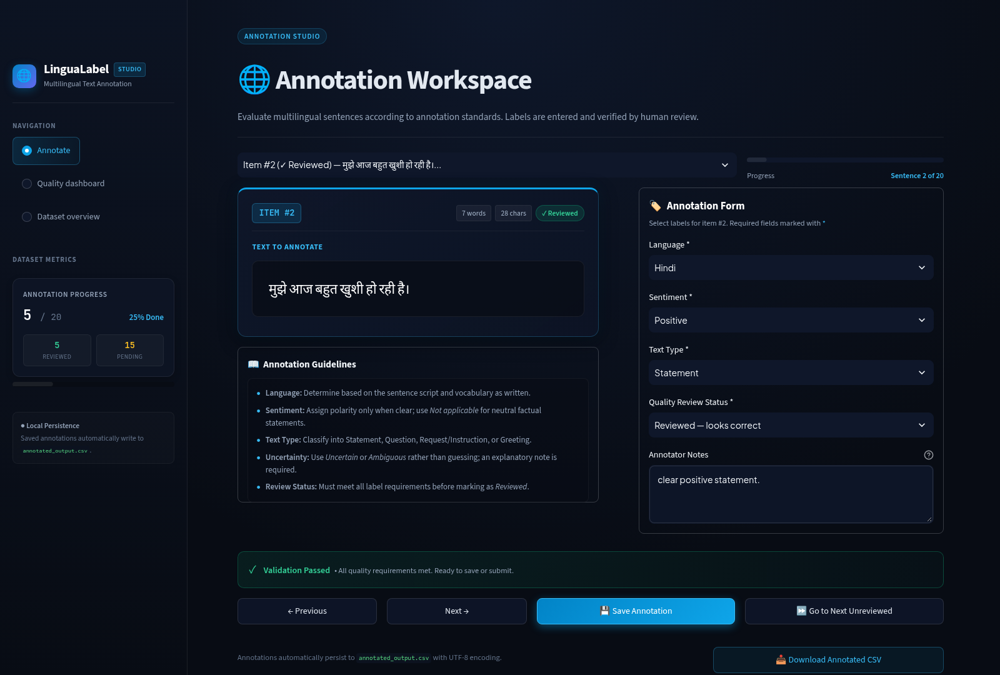
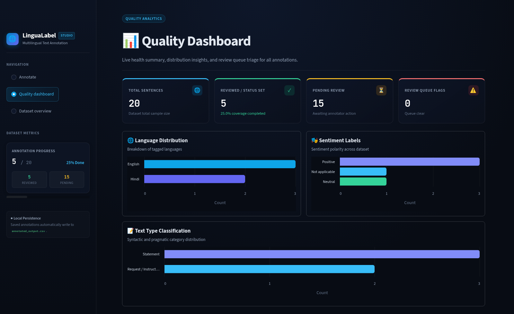
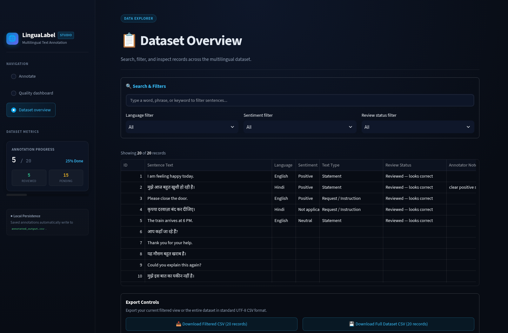

# LinguaLabel — Multilingual Text Annotation & Quality Review

A beginner-friendly, human-in-the-loop annotation tool for English and Hindi sample sentences. It is designed to demonstrate careful labeling, uncertainty handling, review notes, and CSV data quality workflows.

## Features

- Review one sentence at a time
- Assign language, sentiment, and text-type labels
- Mark an item as reviewed, needing a second review, ambiguous, or skipped
- Add notes to explain uncertain decisions
- Save work locally to `annotated_output.csv`
- View the full dataset and download CSV files

## Requirements

- Python 3.10 or newer
- Internet access for the initial installation of packages (the app itself processes data locally)

## Run on Linux (Fedora) or Windows

Open a terminal in this project folder.

### 1. Create a virtual environment

Linux / Fedora:
```bash
python3 -m venv .venv
source .venv/bin/activate
```

Windows PowerShell:
```powershell
py -m venv .venv
.\.venv\Scripts\Activate.ps1
```

### 2. Install dependencies

```bash
python -m pip install -r requirements.txt
```

### 3. Launch the app

```bash
streamlit run app.py
```

Streamlit will print a local URL, usually `http://localhost:8501`. Open it in your browser.

## Annotation schema

- `language`: English, Hindi, Other, Uncertain
- `sentiment`: Positive, Negative, Neutral, Not applicable, Uncertain
- `text_type`: Statement, Question, Request / Instruction, Greeting, Other, Uncertain
- `review_status`: Reviewed — looks correct, Needs second review, Ambiguous, Skip
- `annotator_notes`: optional explanation

## Important

This project does not automatically determine the correct labels. You make the annotation decisions using the written guidelines. The example dataset is a practice dataset, not an official dataset from any employer or client.

Before using it in a real annotation project, follow that project's own instructions and label definitions. Do not claim professional annotation experience based only on this practice project.

## Suggested portfolio description (after you have actually completed it)

**LinguaLabel — Multilingual Text Annotation & Quality Review**
- Built a Streamlit tool for manually labeling English and Hindi text by language, sentiment, and text type.
- Added review statuses, annotator notes, and CSV export to support consistent annotation and quality checks.
- Implemented local CSV persistence so annotations can be saved and reviewed without a cloud service.
## Screenshots

### 1. Annotation Workspace
Interactive labeling studio featuring sentence tokenization metrics, multilingual text display (English & Hindi), schema selection forms, live validation checklist, and annotator note-taking.



### 2. Quality Analytics Dashboard
Live metrics tracking overall annotation progress, coverage percentage, label distributions (Language, Sentiment, and Text Type), and review triage queue.



### 3. Dataset Overview & Search Filters
Searchable and filterable data explorer allowing multi-attribute filtering (language, sentiment, review status), tabular dataset inspection, and UTF-8 CSV exports.

