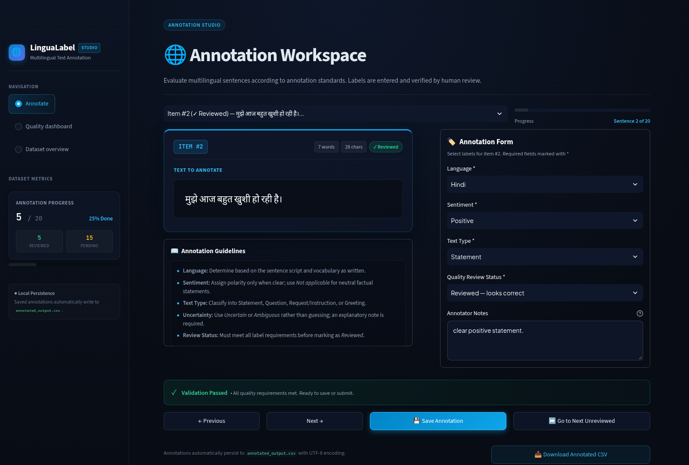
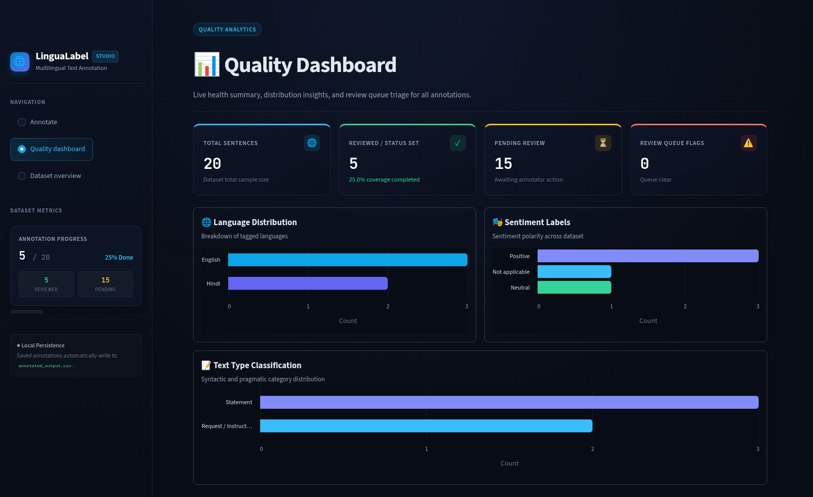
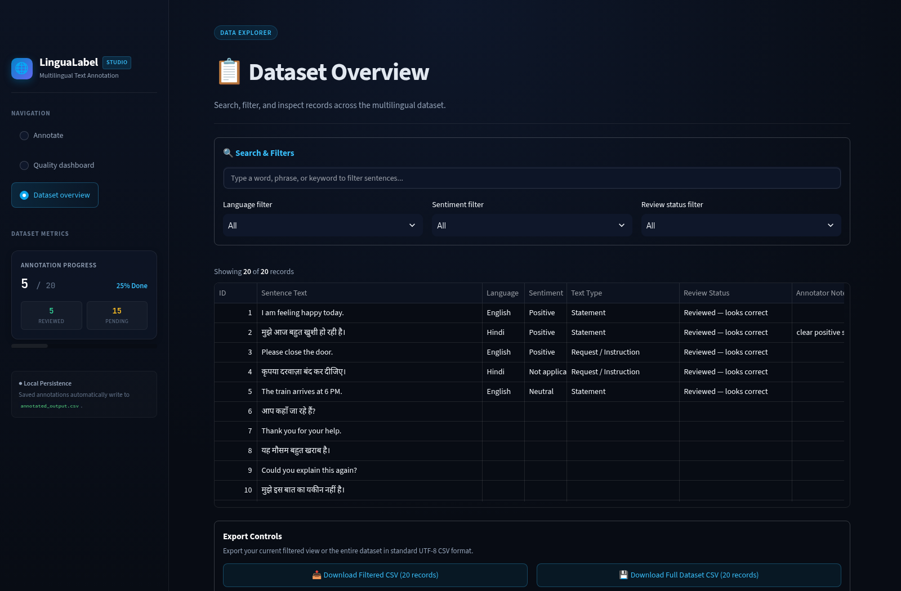

# LinguaLabel — Multilingual Text Annotation & Quality Studio

A production-grade, human-in-the-loop annotation platform and quality review system for multilingual text (English, Hindi, and transliterated scripts). LinguaLabel pairs an intuitive, Linear/Vercel-inspired dark-mode user interface with modular machine learning inference, robust dataset ingestion, and strict quality assurance validation rules.

---

## Key Features

### 1. Multi-Source Dataset Ingestion & Column Mapping
- **Built-in Sample Dataset**: Ships with a curated 20-sentence seed dataset covering English, Devanagari Hindi, and transliterated utterances.
- **Custom CSV Upload**: Upload any CSV dataset with automatic encoding detection (`utf-8`, `utf-8-sig`, `latin-1`, `cp1252`) and delimiter detection (comma, tab, semicolon).
- **Interactive Column Selector**: Preview uploaded data and dynamically choose which column contains the text to annotate (auto-detects `text`, `sentence`, `content`, `utterance`, `review`).
- **Deterministic Stable IDs**: Preserves existing `id` columns or generates deterministic content hashes to guarantee annotation stability across reruns.
- **Storage Isolation**: Saves annotations separately per dataset source, guaranteeing that uploaded datasets never overwrite sample annotations.

### 2. Human-in-the-Loop Annotation Studio
- **Advisory ML Assistance**: Suggests labels for Language, Sentiment, and Text Type with calibrated confidence scores (e.g., `96% confidence`) and transparent provenance pills (`Script Heuristic`, `Lexicon Rules`, `N-Gram Classifier`).
- **Non-Destructive Contract**: AI predictions are strictly advisory; they populate form controls only upon explicit user request and never commit to disk without human confirmation.
- **Uncertainty Guardrails**: Predictions with confidence below 60% are flagged with an explicit `⚠️ Low confidence` alert and default to `Uncertain`, prompting annotators for mandatory explanatory notes.
- **1-Click Suggestion Application**: Apply individual suggestions or use the **Accept All Suggestions** button for fast triage.
- **Navigation Safety & Auto-Save**: Prevents data loss by checking for unsaved changes during navigation (`Previous`, `Next`, `Jump to Sentence`, `Go to Next Unreviewed`). Automatically saves valid edits and alerts the user if required fields are missing.

### 3. Rigorous Quality Validation Rules
The platform enforces four mandatory quality validation rules before marking records as reviewed:
1. **Full Schema Completion**: All four schema fields (`language`, `sentiment`, `text_type`, `review_status`) must be selected.
2. **Mandatory Uncertainty Notes**: Any label marked as `Uncertain` requires an explanatory annotator note.
3. **Reviewed Status Lockout**: Marking as `Reviewed — looks correct` is blocked if any label is empty or uncertain.
4. **Triage Rationale**: Explanatory notes are required for any triage status (`Needs second review`, `Ambiguous`, `Skip`).

### 4. Modular Machine Learning Engine (`ml/`)
- **Language Identification**: Fast Unicode script heuristic evaluating Devanagari codepoints (`U+0900..U+097F`) vs. Basic Latin (`A..Za..z`), paired with character n-gram TF-IDF for ambiguous or transliterated text.
- **Sentiment Polarity**: Curated bilingual polarity lexicons with contextual bidirectional negation parsing (`नहीं`, `मत`, `ना` in Hindi; `not`, `never`, `no` in English) plus statistical TF-IDF classification.
- **Text Type Classification**: Syntactic token matcher identifying questions (`?`, `क्या`, `who`, `why`), greetings (`नमस्ते`, `hello`), and requests (`कृपया`, `please`), backed by an n-gram intent classifier.
- **Empirical Evaluation CLI**: Run `python -m ml.evaluate` to compute exact accuracy, precision, recall, macro-F1, and confusion matrices against ground truth.

### 5. Quality Analytics & Data Explorer
- **Quality Dashboard**: Real-time progress tracking, reviewed vs. pending counts, label distribution charts, and quality queue reviews.
- **Dataset Overview & Triage Queues**: Quick-filter by `All Records`, `Pending / Unreviewed`, `Completed / Reviewed`, and `Follow-Up Queue`, combined with full-text keyword search.
- **UTF-8 with BOM Export**: Download filtered or complete datasets encoded in `utf-8-sig` to preserve Devanagari Hindi characters cleanly in Excel, pandas, and external tools.

---

## Installation & Setup

### Requirements
- Python 3.10 or newer (tested on Python 3.14.8)
- Virtual environment recommended

### 1. Clone & Set Up Environment
```bash
# Clone the repository
git clone https://github.com/Arshhh26/LinguaLabel.git
cd LinguaLabel

# Create and activate virtual environment
python3 -m venv .venv
source .venv/bin/activate  # On Windows: .venv\Scripts\Activate.ps1

# Install dependencies
pip install -r requirements.txt
```

### 2. Launch the Web Application
```bash
streamlit run app.py
```
Open `http://localhost:8501` in your browser.

---

## Annotation Schema

| Field | Allowed Values | Description |
|---|---|---|
| `language` | `English`, `Hindi`, `Other`, `Uncertain` | Detected or verified language script/vocabulary. |
| `sentiment` | `Positive`, `Negative`, `Neutral`, `Not applicable`, `Uncertain` | Polarity of the sentence; use *Not applicable* for factual directives. |
| `text_type` | `Statement`, `Question`, `Request / Instruction`, `Greeting`, `Other`, `Uncertain` | Communicative intent or syntactic form. |
| `review_status` | `Reviewed — looks correct`, `Needs second review`, `Ambiguous`, `Skip` | Triage state for human review pipelines. |
| `annotator_notes` | Free-form text | Explanatory rationale (mandatory for uncertain/triage items). |

---

## Running the Automated Test Suite

LinguaLabel includes a comprehensive test suite (45 tests) covering data ingestion, workflow validation, ML detectors, navigation edge cases, and graceful degradation:

```bash
# Run full pytest suite
python -m pytest
```

### Test Suite Structure
- `tests/test_upload_and_ids.py`: Multi-encoding CSV parsing, column detection, delimiter sniffing, and stable deterministic IDs.
- `tests/test_part1_integration.py`: Ingestion pipeline integration and storage path isolation.
- `tests/test_workflow.py`: The 4 validation rules, boundary navigation safety, next-unreviewed resolution, and UTF-8-SIG export.
- `tests/test_ml_language.py`: Script heuristic, Latin/Devanagari codepoint checks, transliterated text, and fallback behavior.
- `tests/test_ml_sentiment.py`: Polarity scoring, bidirectional Hindi & English negation parsing, and neutrality detection.
- `tests/test_ml_text_type.py`: Syntactic matching for questions, greetings, requests, and declarative statements.
- `tests/test_degradation.py`: Graceful degradation, availability checks, and non-destructive contracts.

---

## Running Empirical Model Evaluation

Evaluate the ML engine against ground truth labeled datasets without any fabricated numbers:

```bash
# Evaluate against default annotated output
python -m ml.evaluate --dataset annotated_output.csv

# Evaluate against custom ground truth dataset
python -m ml.evaluate --dataset path/to/ground_truth.csv
```

Outputs formatted classification reports with:
- Overall Accuracy
- Macro-averaged Precision, Recall, and F1-Score
- Per-class Precision, Recall, and F1-Score
- Formatted Confusion Matrix (Actual vs. Predicted)

---

## Architecture Overview

```
LinguaLabel/
├── app.py                     # Streamlit frontend & interactive annotation studio
├── data_manager.py            # Ingestion, encodings, stable IDs, and storage isolation
├── requirements.txt           # Project dependencies
├── sample_data.csv            # Default seed multilingual dataset (20 sentences)
├── ml/                        # Modular machine learning package
│   ├── base.py                # PredictionResult dataclass & BasePredictor interface
│   ├── engine.py              # MLEngine coordinator with is_available() checks
│   ├── language_detector.py   # Script heuristics + char n-gram classifier
│   ├── sentiment_detector.py  # Bilingual polarity lexicon + negation parser
│   ├── text_type_detector.py  # Syntactic pattern matcher + intent classifier
│   ├── evaluate.py            # Standalone CLI evaluation harness
│   └── lexicons/              # Curated keyword & polarity dictionaries
│       ├── hindi_sentiment.json
│       ├── english_sentiment.json
│       └── text_type_keywords.json
├── tests/                     # 45 automated pytest suites
│   ├── test_upload_and_ids.py
│   ├── test_part1_integration.py
│   ├── test_workflow.py
│   ├── test_ml_language.py
│   ├── test_ml_sentiment.py
│   ├── test_ml_text_type.py
│   └── test_degradation.py
└── screenshots/               # UI preview screenshots
```

---

## Screenshots

### 1. Annotation Workspace


### 2. Quality Analytics Dashboard


### 3. Dataset Overview & Search Filters
